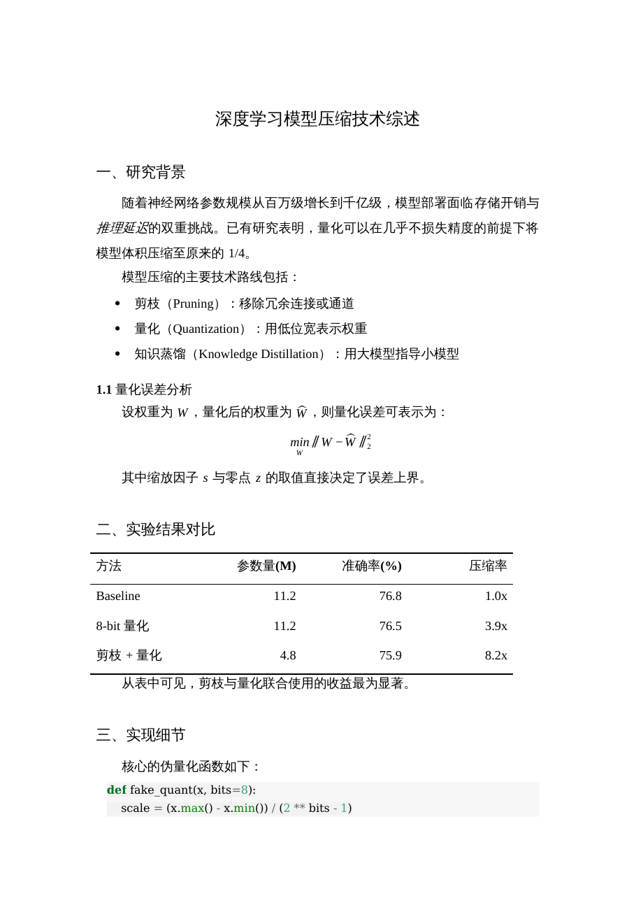

# AI 回答 → Word：复制过来就是好格式

把 ChatGPT / DeepSeek / Claude / 豆包 等 AI 聊天的回答，变成**粘到 Word 就是排版好的正文**——
真·Word 标题样式（导航窗格、自动目录可用）、宋体小四、1.5 倍行距、首行缩进 2 字、
三线表、**可编辑的原生公式**（不是图片、不是乱码）。

> 你从网页上 Ctrl+C 复制 AI 回答，粘到 Word 里为什么总是乱的？
> 因为 Word 粘贴时只认它自己懂的那套样式（`<w:pStyle>` + 内联样式），
> 网页里的 CSS class、flex 布局、`<pre>` 高亮它一概不认，公式更是直接变成一串字符。
> 本项目干的就是中间这一步：**把 Markdown 重新渲染成「Word 能看懂的 HTML」**，
> 或者干脆直接给你一个 `.docx`。

## 它长什么样



`docs/page-1.png` / `docs/page-2.png` 是实际输出截图，`docs/out_test.pdf` 是同一份文档的 PDF。

## 三种用法

| 用法 | 适合谁 | 要装什么 |
|---|---|---|
| ① 网页版：粘贴 → 下载 Word / 复制为 Word 格式 | 任何人，手机也行 | 什么都不用装 |
| ② Windows 一键：Ctrl+C 复制 AI 回答 → 双击 `wordclip.bat` → Word 里 Ctrl+V | 经常写报告的人 | 系统自带 PowerShell，零安装 |
| ③ 命令行：`python3 wordclip.py in.md > out.html` | 想批量/脚本化转换的人 | Python + pandoc |

（`wordclip.py` 的标准输出是**带 Word 命名空间的剪贴板 HTML**；
要 `.docx` 文件就走 ① 的「下载 Word 文件」接口，那边由 pandoc + `ref.docx` 直接生成原生 docx。）

### ① 网页版

```bash
docker compose up -d --build      # 需要 Docker
# 打开 http://127.0.0.1:8020
```

页面左上角粘贴 Markdown，右上角有「排版设置」：几套预设（公文/学术/报告/极简）+
字号、行距、缩进、表格风格、西文字体等微调，实时预览，然后
「下载 Word 文件」或「复制为 Word 格式」（直接进剪贴板，去 Word 粘贴即可）。

### ② Windows 客户端（零安装）

```powershell
# 1) 先把默认服务器地址改成你自己的
python build_client.py --set-server https://your-server.example.com

# 2) wordclip.ps1 和 wordclip.bat 放同一个文件夹，双击 wordclip.bat
```

原理：不复制网页 HTML，而是把剪贴板里的 Markdown 发到服务器换成
「全是内联样式 + Word 命名空间」的 HTML，再写进剪贴板 **HTML Format** 槽位。
Word 粘贴时优先读这个槽位，于是拿到的是真样式。

> 不想架服务器？`clipboard/` 里那份 `wordclip.ps1` 支持纯本地运行
> （`-Server` 指向本机 8020，或直接用 `wordclip.py` 离线转 docx）。

### ③ 命令行

```bash
sudo apt-get install -y pandoc fonts-noto-cjk
pip install -r requirements.txt

python3 wordclip.py sample.md > out.html    # 剪贴板 HTML，浏览器打开后 Ctrl+A/Ctrl+C
```

## 排版是怎么做出来的（技术要点）

1. **参照文档（reference.docx）**：`build_reference.py` 用 python-docx/zipfile 直接改
   pandoc 参照文档的 `styles.xml`——正文=宋体小四、行距 1.5、首行缩进 2 字、
   一级标题黑体三号居中…… 这是 Word 侧看到"真样式"的根。
2. **HTML 出口（剪贴板用）**：pandoc `-t html` 拿到结构，再用 `wordclip.py` 里的
   后处理器把标题/表格/代码块/公式改写成**内联样式**，因为剪贴板 HTML 不能带
   `<style>` 之外的 class 语义，Word 只认内联。
3. **公式**：走 OMML（Office Math），Word 里能双击编辑。网页复制过来的 LaTeX
   先归一化（`\( \)`/`\[ \]`/`$$`/`$`），再交由 pandoc 转。
4. **表格**：三线表（顶线/表头下线/底线粗，其余无线），列宽按内容长度分配。
5. **代码块**：等宽字体 + 底纹 + `keepNext`，不被分页拆开。
6. **中文断行**：输出里显式写 `w: kinsoku`/`overflowPunct` 相关段落属性，
   避免行首出现标点。

## 服务端

- 单文件 Flask（`app.py`）+ 标准库 + pandoc 命令行，无数据库、无 ORM。
- `POST /api/docx` 返回 .docx；`POST /api/clip` 返回 Word 剪贴板 HTML；`GET /api/health`。
- **不落盘用户内容**：临时目录用完即删，不写日志正文。
- 可选令牌：`.env` 里设 `MD2W_TOKEN`（`gen-token.sh` 可生成），
  请求头带 `X-Token`；不设则只允许回环地址调用。

```bash
./gen-token.sh            # 生成令牌到 .env（600）
docker compose up -d      # nginx 反代到 127.0.0.1:8020
```

nginx 片段（按需改域名/证书）：

```nginx
location /md2word/ {
    proxy_pass http://127.0.0.1:8020/;
    proxy_set_header Host $host;
    proxy_set_header X-Forwarded-Proto $scheme;
    client_max_body_size 2m;
}
```

## 目录

```
app.py                Flask 服务（/api/docx、/api/clip、/api/health）
wordclip.py           Markdown -> Word 剪贴板 HTML / docx 的核心转换器
build_reference.py    生成/修改 pandoc 参照文档（改排版参数改这里）
wordclip.ps1/.bat     Windows 零安装客户端
clipboard/            纯本地版客户端（不依赖服务器）
build_client.py       把占位符 @@SERVER_PLACEHOLDER@@ 换成你的默认地址
pack-win.py/.sh       给自己的用户打包带令牌的客户端 zip
sample.md             示例输入
docs/                 实际输出效果（png / pdf）
selftest.py e2e_test.py  自测与端到端测试
```

## 已知限制

- 图片：Markdown 里的本地图片在剪贴板模式下会被丢掉（纯文本剪贴板没带图），
  HTTP 图片可以保留；`.docx` 下载模式不受影响。
- 复杂 LaTeX（`align` 环境、自定义宏）交给 pandoc 处理，个别会退化成文本。
- 网页版没有任何账号体系，是"自己的小工具"定位；要公开服务请自己加鉴权
  和限流（`app.py` 里已带令牌校验和输入长度上限）。

## License

MIT
